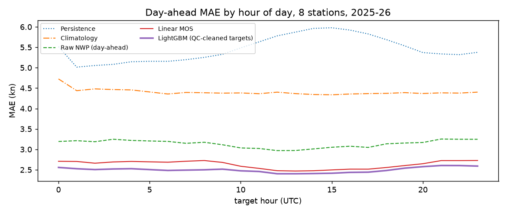
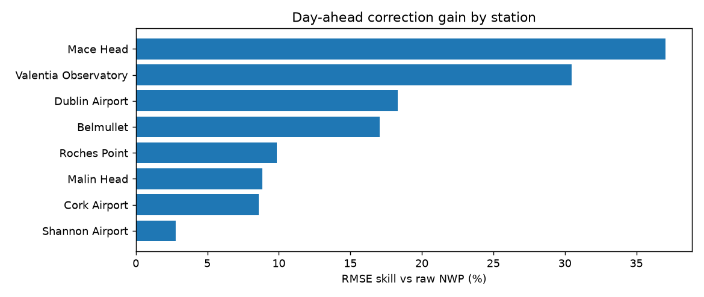
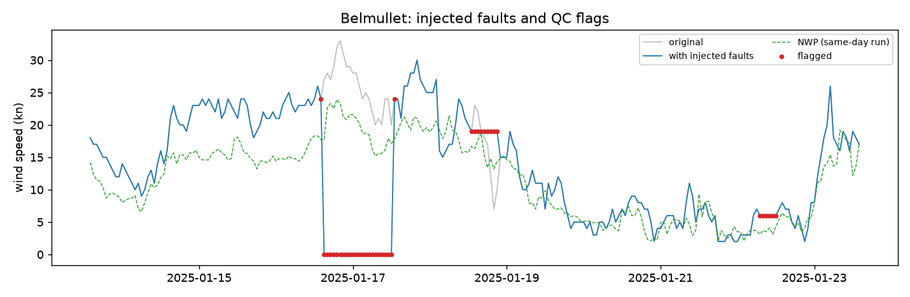

# Irish Wind Data QC and Day-Ahead Forecast Correction

Wind measurements fail in quiet ways. A frozen anemometer repeats one value for hours, a failed cup reads zero in a gale, and worn bearings make a sensor read low for days. A forecast trained on those readings learns the faults. This project works on public data from 8 Met Éireann stations and does two things:

1. **Quality control.** Flags faulty hourly wind readings with rule-based checks plus a check against a weather model, and writes cleaning logs in the format the [brightwind](https://github.com/brightwind-dev/brightwind) library reads.
2. **Day-ahead forecasting.** Corrects a numerical weather prediction (NWP) forecast made 48 hours before each target hour, and tests it against four baselines on a monthly-retrained rolling backtest.

## Results

### Day-ahead forecast (8 stations, forecasts issued 1 Jan 2025 to 28 Sep 2026)

Forecasts are issued at 00:00 UTC on day D for every hour of day D+1 (lead 25 to 48 h). Scored on 115,161 hours that every model covers and that QC did not flag.

| Model | MAE (kn) | RMSE (kn) | RMSE skill vs persistence | RMSE skill vs raw NWP |
|---|---|---|---|---|
| Persistence (last observation) | 5.46 | 7.12 | 0 | -71.5% |
| Seasonal naive (same hour, 48 h earlier) | 5.42 | 7.12 | +0.1% | -71.4% |
| Climatology (station, month, hour) | 4.40 | 5.66 | +20.5% | -36.3% |
| Raw NWP | 3.14 | 4.15 | +41.7% | 0 |
| Linear MOS (per-station regression on NWP) | 2.63 | 3.47 | +51.2% | +16.4% |
| **LightGBM correction** | **2.50** | **3.34** | **+53.2%** | **+19.7%** |

- The LightGBM correction cuts RMSE by **19.7% against the raw NWP** (95% CI 18.5% to 20.9%, bootstrap over forecast days) and by 53.2% against persistence (CI 51.5% to 54.7%).
- The gain varies by station, from +2.8% at Shannon Airport to +37.1% at Mace Head ([by station](results/forecast_by_station.csv)).
- **Training on QC-cleaned targets made no measurable difference** (skill against the raw-target model, CI -0.2% to +0.1%). Flagged hours are rare in 2025-26 (0.7% to 1.7% per station), so removing them from training barely changes the model. The cleaning matters more for the scoring set than for training.




### Quality control (fault injection, 2025-26)

Met Éireann's own defect codes can't serve as labels. Codes 3 to 6 ("defective") cover a few hundred hours, almost all before 2000, and code 111 ("investigation required") marks whole decades at some stations. So the evaluation plants faults with known positions in real data: per station, 20 each of stuck sensor (6-36 h), spike, sensor reading zero (6-24 h) and degraded sensor reading 60% of the truth (2-7 days). Thresholds were tuned on 2024 only, then scored on 2025-26 over 5 fresh placements.

| Fault | Event recall, point checks | Event recall, + NWP consistency check |
|---|---|---|
| Stuck sensor | 100% | 100% |
| Spike | 97.4% | 97.4% |
| Sensor reads zero | 0.9% | **93.4%** |
| Degraded (reads low) | 65.6% | **96.0%** |
| Hour-level recall, all faults | 23.2% | **51.2%** |
| False-alarm rate on unaltered hours | 1.4% | 1.8% |

- The NWP consistency check compares a 12-hour rolling ratio of observed to modelled wind with the station's typical ratio. It is the only check that sees zero and low-reading faults, which look plausible hour by hour.
- Hour-level recall stays near half because a long degraded fault is often caught only in its windiest hours. At least one hour is flagged in 96% of those events.
- False alarms are counted against "clean" hours that may hold real, unlabelled faults, so the true false-alarm rate is likely lower.
- **Against Met Éireann's historical defect codes** (Malin Head 1980-99, 302 coded hours), the rules catch only 2% ([raw counts](results/qc_malin_labels.json)). Those codes describe the instrument's status, not anomalous values, which is why the main evaluation uses injected faults.



Per-station cleaning logs: [`results/cleaning_logs/`](results/cleaning_logs/). Tuned thresholds and station scales: [`results/qc_params.json`](results/qc_params.json).

## Method

**Leakage control.** For target hour `t` the issue time is `floor_day(t - 1 h) - 1 day`. Every feature is known at that moment:

| Feature | Source | Why it is safe |
|---|---|---|
| NWP speed and direction | Open-Meteo `_previous_day2`, "predicted 48 hours before valid time" | made at or before the issue time |
| Last observation, 24 h mean | Met Éireann | ends at the issue time |
| 7-day NWP bias | mean(obs - NWP) over 7 days | ends at the issue time |
| Hour, day of year, lead, station | calendar | known in advance |

`tests/test_dayahead.py` replaces every observation after the issue time with 999 and checks that no feature changes. Open-Meteo's *Historical Forecast* API stitches the newest run for each hour, so it is not used. Open-Meteo defines the lead by valid time, not by when a run was published, so a run's few hours of publication delay are not modelled.

QC uses centred windows. It is a retrospective cleaning step: QC flags clean the training and scoring targets but never feed forecast features.

**Backtest.** One model per test month, trained on every target hour at or before that month's first issue time. Skill is `1 - RMSE_model / RMSE_reference` on rows common to all models. Confidence intervals resample whole forecast days, because errors within a day are correlated.

**QC checks** (`src/windqc/qc.py`): out of range; flat line (at least 6 identical non-zero hours, never bridging a gap); spike (more than 8 rolling MADs from a 7-hour median); step (more than 30 kn in one hour); NWP consistency (12-hour observed/model ratio, normalised by the station's 2024 median, outside 0.65 to 2.5 while the model expects at least 8 kn).

## Service

```bash
uvicorn windqc.api:app
```

- `POST /qc` returns per-hour flags for a posted series.
- `POST /forecast` takes a station, a 00:00 UTC issue time, the last 7 days of observations and the `_previous_day2` NWP values, and returns the corrected forecast for the next day.

```bash
docker build -t windqc . && docker run -p 8000:8000 windqc
```

GitHub Actions runs lint, tests and the Docker build on every push.

## Reproduce

```bash
python -m venv .venv && source .venv/bin/activate
pip install -e ".[dev,model]"
pytest
python scripts/download_met.py 532 1575 2375 2275 518 3904 1075 275   # about 400 MB
python scripts/download_nwp.py                                        # 2024-01-01 to 2026-09-30
python scripts/run_qc_eval.py      # QC experiment, about 15 s
python scripts/run_forecast.py     # backtest, about 3 min; writes models/
```

## Data

| Source | Used for | Licence |
|---|---|---|
| [Met Éireann hourly station data](https://www.met.ie/climate/available-data/historical-data) | observed wind speed (kn) and quality indicators | CC BY 4.0 |
| [Open-Meteo Previous Runs API](https://open-meteo.com/en/docs/previous-runs-api) | archived NWP wind at 0, 1 and 2 day leads, from January 2024 | CC BY 4.0 |

Stations: Dublin Airport (532), Malin Head (1575), Belmullet (2375), Valentia Observatory (2275), Shannon Airport (518), Cork Airport (3904), Roches Point (1075), Mace Head (275).

## Limitations

- The NWP archive starts in January 2024, so the monthly models train on one to two and a half years.
- Point forecasts only. Quantile forecasts scored with pinball loss are the natural next step.
- Station wind at 10 m, not turbine power. Linking to EirGrid wind generation would need generation data or a power curve.
- QC thresholds are pooled across stations. Per-station tuning may cut false alarms at sheltered sites.

## Reading

Sources behind the method choices, including MIT OpenCourseWare notes and *Forecasting: Principles and Practice*: [docs/READING.md](docs/READING.md).

## Attribution

Contains data from Met Éireann (CC BY 4.0) and Open-Meteo (CC BY 4.0).
